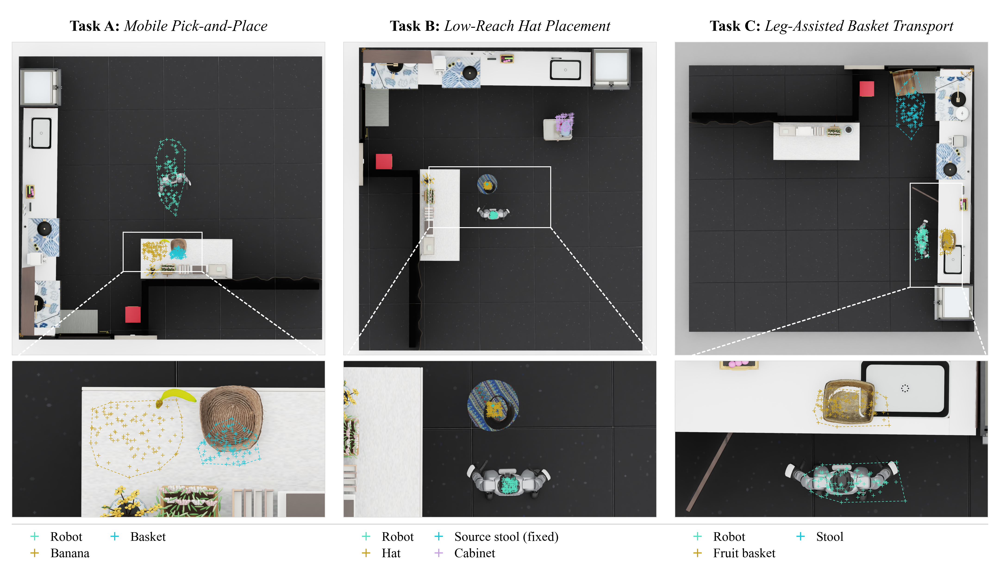

# 📊 Evaluation Protocol

Each task is evaluated on **100 fixed configurations** from the checked-in [manifests](../configs/manifests). All models use the same initial states, observations, control settings, and success criteria.

## Scenes and Sampling

*Tasks 1–3 (A–C), with 100 configurations each. Crosses mark sampled XY asset-root positions; dashed outlines show their convex hulls. Task 3 positions use the nominal scene frame.*

All three tasks use textured Astra visual scenes and Astra static collision geometry, with a separate ground plane. Tasks 1 and 2 share a scene asset; Task 3 uses its own scene. Task-specific movable objects and the articulated cabinet door retain their own assets. Scene and texture checksums are verified before launch.

## Observations and Control

| Setting | Value |
| --- | --- |
| Observations | Egocentric RGB, 34-dimensional robot state, and task instruction |
| Actions | 64-dimensional SONIC latent commands and two hand commands |
| Executed steps per inference | 16 for Task 1; 40 for Tasks 2 and 3 |
| Maximum horizon | 2,000 policy-control steps |
| Environments per client | 1 |

See the [server/client guide](server_client.md#adapting-another-model) for the model interface.

## Success Criteria

Success is computed from simulator state:

| Task | Criterion |
| --- | --- |
| **1 · Mobile Pick-and-Place** | Lift the object and place it within the basket's target region with low final velocity. |
| **2 · Low-Reach Hat Placement** | Place the hat in the cabinet target region and maintain a stable pose. |
| **3 · Leg-Assisted Basket Transport** | Trigger the door interaction and place the basket stably on the stool. |

Exact thresholds are defined in the [task evaluation code](../runtime/pick_place).

## Evaluation Videos

Episodes **10, 20, …, 100** automatically save synchronized first-person and third-person recordings. The first-person view uses the policy's GS background and mesh foreground; the third-person view renders the scene mesh from the task's overview camera. Both videos cover the same control steps at the same frame rate.

Within each task output, the recordings are stored in `sim/sim_eval/videos/<scenario_id>/ego.mp4` and `third_person.mp4`. `episodes.csv` records both paths and the frame count. The interval is set by `--diagnostic_video_interval` in the task config and follows the full manifest numbering when evaluating a subset.

The first frame of each view is also saved as `ego.png` and `third_person.png` beside the videos, so camera placement can be inspected while the episode is running.

## Reporting Results

Report successful episodes out of **all 100 configurations** per task, together with failures and execution errors. Keep the episode records, `launch.json`, and the [server checkpoint record](server_client.md#checkpoint-records) with the results. Two-episode runs are intended for installation checks.
